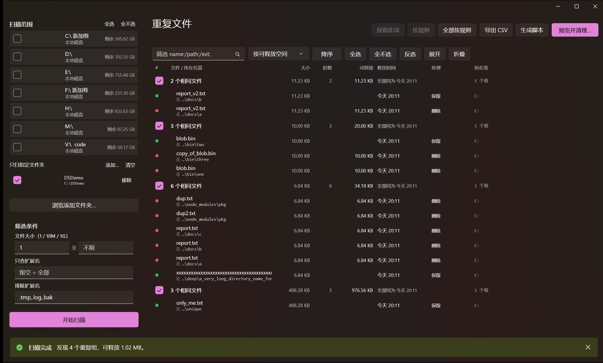
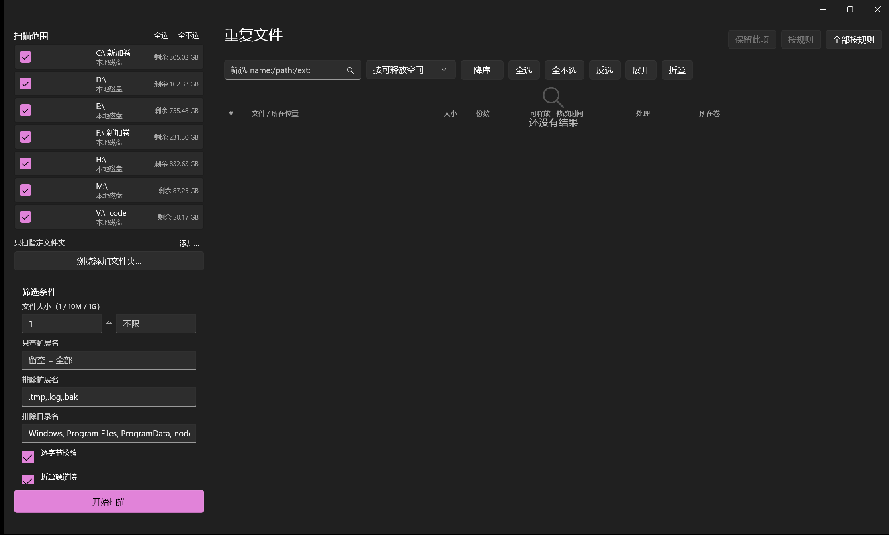
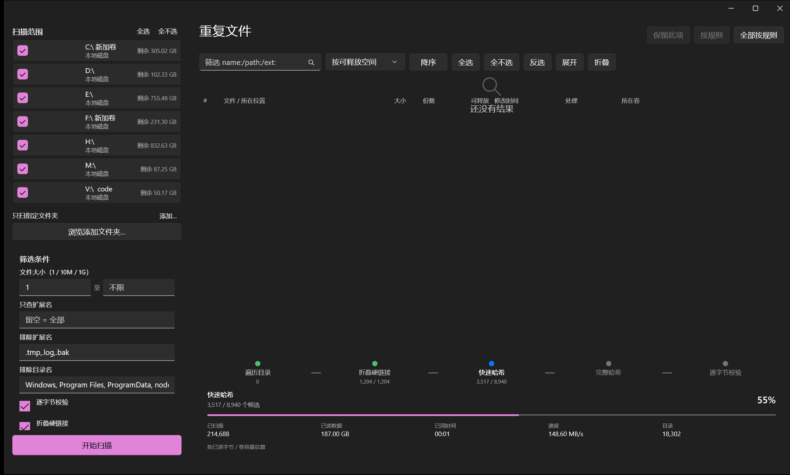

# Dump Search · 全盘重复文件查找与安全清理

Windows 桌面工具。**按内容**找出全盘重复文件，分层比对把"读全文"压到最少文件上，
清理时默认**移入回收站**（可撤销），并且必须**先预览、再确认**。



**两个前端，共用同一套安全契约：**

| | 技术栈 | 适合 |
|---|---|---|
| **WinUI 3** | C# / .NET 8 / 原生 XAML | 日常使用。深色模式、Mica 材质、逐组指定保留哪一份、悬停看详情 |
| **Python / Tkinter** | 纯标准库，零第三方依赖 | 想要一份能直接读懂全部逻辑的源码，或在没有 .NET 的机器上跑 |

两边算法与安全设计一致（分层过滤 / 硬链接折叠 / 逐字节校验 / 回收站回滚 /
删除前审计），代码各写一份——UI 框架不同，强行共用只会把两边都写坏。

> 判断"该删哪一份"靠的是**位置**和**修改时间**，所以列表把文件名和所在目录
> 合成一列，时间显示成「今天 17:14」「3 天前」这种相对形式——让人心算两个
> `yyyy-MM-DD` 的差值是没必要的负担。

---

## 快速开始

### WinUI 3（推荐）

从 [Releases](../../releases) 下载 `DumpSearch-v*-win-x64-selfcontained.zip`，
解压双击 `DumpSearch.exe` 即可，**不需要安装 .NET 或 Windows App Runtime**（自包含）。

> 系统要求：Windows 10 1809 (17763) 及以上，x64。

不想下载 zip、想自己构建的话，仓库里有启动器和快捷方式生成脚本：

```bat
启动 WinUI 3 界面.bat                        :: 自动找 exe，必要时先构建
python winui\tools\make_shortcut.py          :: 生成带图标的快捷方式
python winui\tools\make_shortcut.py --desktop :: 顺便在桌面放一份
```

自行构建（需要 .NET 8 SDK）：

```bat
cd winui\src\DumpSearch.App
dotnet build -c Release
python ..\..\tools\package_release.py    :: 打出发布 zip
```

详见 [`winui/README.md`](winui/README.md)，那里记录了 WinUI 3 侧的全部设计决策
和构建踩坑。

### Python

```bat
启动图形界面.bat          :: 图形界面
命令行示例.bat            :: 命令行用法演示
```

或手动：

```bat
python -m dupehunter --gui          :: 图形界面
python -m dupehunter --list-drives  :: 列出可用盘符
python -m dupehunter D:\            :: 扫描 D 盘（只报告，不删除）
python -m dupehunter D:\ --delete   :: 扫描并进入清理流程（会先确认）
python tools\verify_all.py          :: 跑完全部验证
```

---

## 核心设计

### 1. 分层比对：把最贵的动作压到最后

全盘动辄几十万文件。**每个文件都读全文算哈希是不可接受的**，所以分四层过滤，
越往后候选越少、代价越高：

| 阶段 | 依据 | 代价 |
|---|---|---|
| 1 | 文件大小 | **免费**（`scandir` 时顺带拿到） |
| 2 | 头/中/尾三段采样 + BLAKE2b-128 | 每文件约 12 KB |
| 3 | 全文 BLAKE2b-256 | 读全文一次 |
| 4 | 逐字节比对（默认开启） | 读全文一次，不做哈希 |

第 2 层刻意采样**三段**而不是只取头部：很多文件（改过时间戳的镜像、只更新了尾部的
日志/字幕、ZIP 之后的中央目录）头部完全一致，只比头部会产生大量假候选，
把第 3 层的代价压不出去。

第 4 层是"删除前的最后一道确认"。没有任何哈希实现能 100% 排除碰撞，直接比字节可以。

实测 4 万行规模下，全文哈希阶段用 **1 MiB** 块 + `readinto` 复用缓冲区，
`hashlib` 释放 GIL 能拿到约 **5x** 线程扩展；用 4 KiB 块只有 0.7–1.8x，
用 4 MiB 反而掉回 3.3x。

### 2. 删除默认安全

* 一律走 **Windows 回收站**，不是 `os.remove()`。
* 清理前弹出**预览清单 + 风险审计**，必须显式勾选确认框才能继续。
* 审计会主动提醒：跨盘删除、极小文件（配置/占位文件）、保留策略可能选错方向等。
* 提供「生成删除脚本」——只输出 PowerShell 文本供人工审阅，**不执行**。

### 3. 结果表虚拟化

全盘扫描可能产出几万个重复组、几十万文件行。`ttk.Treeview` 一次性插入这么多行
会直接卡死。本工具让**数据全在内存、Treeview 只物化可视区 ± 一屏**：

```
数据量 39,974 行  ->  Treeview 峰值物化 93 行（0.23%）
```

关键点：**滚动位置必须由外部模型自己维护**。`Treeview` 自己的 `yview()` 是相对
"当前已插入的行数"算比例的，用它反推窗口会在树里只有几十行时得到
"整份数据集都要物化"的结论——实测会一次性插入近 2 万行。详见 `gui/widgets.py`。

### 4. 勾选状态不随滚动丢失

勾选真源是 Python 里的 `set[str]`，每帧只投影到可见行。
`tree.selection()` 不能当真源——它只看得见**已物化**的行，一滚动就丢。

---

## 目录结构

```
dupehunter/                     Python 前端（纯标准库）
  model.py        数据模型、配置、格式化（纯逻辑）
  winpath.py      Windows 路径工具：长路径、盘符、文件属性位
  scanner.py      阶段 1：目录遍历 + 按大小分组 + 硬链接折叠
  hasher.py       阶段 2/3/4：采样哈希、全文哈希、逐字节比对
  engine.py       流水线编排、并发、进度、取消
  cli.py          命令行入口
  ops/
    trash.py      回收站（长路径 $I/$R 方案 + 回滚）
    actions.py    定位文件、复制到剪贴板
    report.py     CSV / JSON / PowerShell 脚本导出
  gui/
    bus.py        线程通信：单槽进度广播 + 取消令牌
    viewmodel.py  结果视图模型 + 删除计划（纯逻辑，可无头测试）
    theme.py      主题、字体、高 DPI
    widgets.py    虚拟化结果表
    panels.py     扫描配置面板
    app.py        主窗口 + 控制器

winui/                          WinUI 3 前端（C# / .NET 8）
  src/DumpSearch.App/
    App.xaml(.cs)   入口 + 命令行分流
    MainWindow.*     主界面
    SelfTest.cs      116 项引擎自检（不开窗口）
    app.manifest     DPI / UTF-8 / longPathAware
    Core/            与前端无关的引擎（同 dupehunter 的分层设计）
    ViewModels/      结果视图、逐组保留项、扫描进度
    Styles/          设计令牌
  tools/             构建、XAML 检查、图标/快捷方式/发布包生成
  README.md          WinUI 3 侧的设计决策与构建踩坑

tests/test_core.py  47 个单元测试（Python 侧）
tools/              验证脚本（见下）
```

**核心逻辑与 GUI 完全解耦**：`viewmodel.py` / `plan` 不含任何 Tk 代码，
WinUI 侧则是 `Core/` 不含任何 XAML，所以两边都能把
"确认先于删除""取消后零字节被删"变成普通断言，而不用 mock 界面框架。

---

## 验证

**两侧都默认不做任何删除**，测试一律走 dry-run。

```bat
python tools\verify_all.py                            :: Python 侧 6 套
winui\src\DumpSearch.App\bin\Release\...\DumpSearch.exe --selftest <目录>   :: WinUI 侧 116 项
python winui\tools\lint_xaml.py                       :: XAML 静态检查
```

| 脚本 | 验证什么 |
|---|---|
| `tests\test_core.py` | 47 个单元测试：分层过滤、保留策略、虚拟化行映射、勾选、回收站、报告 |
| `tools\verify_trash_safety.py` | 直接数回收站目录条目，验证**长路径没被静默永久删除** |
| `tools\verify_irecord.py` | 校验手写 `$I` 记录的字节布局，Explorer 能据此还原 |
| `tools\virtual_list_stress.py` | 4 万行规模下虚拟化是否受控、内容是否串位 |
| `tools\gui_smoke_test.py` | 真实建窗口、跑扫描、驱动事件循环、截图 |
| `tools\e2e_check.py` | 端到端：干跑/取消/`--dry-run` **必须零删除**，确认后进回收站 |
| `tools\make_fixtures.py` | 生成含 773 字符长路径的受控测试树 |
| `tools\scan_secrets.py` | 提交前扫描暂存区里的用户名、邮箱、本机绝对路径 |
| `tools\scan_release_zip.py` | 扫描发布 zip 里的本机路径（构建过程会往产物里塞） |
| `tools\make_screenshots.py` | 用**中性路径**生成说明页截图，并做字节级核查 |
| `tools\rewrite_author.py` | 转公开前重写 git 历史里的作者邮箱 |
| `DumpSearch.exe --selftest` | WinUI 侧 116 项：长路径可达性、保留策略、逐组保留项、扫描范围、进度模型、悬停详情内容 |
| `winui\tools\lint_xaml.py` | 把"XAML 编译能过、运行时才崩"的坑挡在构建之前（见 `winui/README.md`） |

---

## 界面

| | |
|---|---|
|  |  |

扫描进度是**五级阶段步进器**而不是一根进度条。核心约束：
**总量未知的阶段绝不编造百分比**。遍历目录要先走完才知道有多少文件，
所以那一格只显示「已枚举 N 个文件」；总进度里它用
「已读字节 / 所选卷总容量」参与计算，并在界面底部标明这是**估算**。

---

## 踩过的坑（都已修，代码里有注释）

这些是实测结论，不是从文档抄的；每一条都在对应源码处留了说明。

1. **`os.DirEntry.stat()` 在 Windows 上 `st_ino` / `st_nlink` 恒为 0。**
   它只用 `FindFirstFile` 的结果填字段。后果：基于它做硬链接去重会**静默失效**。
   必须对候选文件补一次完整 `os.stat()`。

2. **路径 > 260 字符时 `SHFileOperationW` 会"成功"地永久删除**，
   不留任何回收站条目。实测 721 / 781 字符的文件回收站计数完全不变且文件消失。
   早期版本的测试只检查"文件没了"就判通过，差点让这个 bug 溜过去。
   现在长路径走手写 `$Recycle.Bin` 的 `$I`/`$R` 方案，**任何一步失败都回滚**。

3. **`\\?\` 前缀不能传给 `SHFileOperationW`。** 批量传前缀稳定返回
   `DE_FILELOCKED(124)` 且文件其实没删；单条传前缀返回 `DE_IOERR(2)` 但文件确实被删
   （返回码不可信）。所以业务层永远传常规路径，前缀只在单次 IO 失败后作降级重试。

4. **哈希后必须复检 `st_size` / `st_mtime_ns`。** Windows 上 `open()` 用
   `_SH_DENYNO`，**可以读到别的进程正在写的文件**，算出来的是磁盘上从未存在过的状态。
   这种文件会被丢弃并计入 `unstable_skipped`。

5. **不能用 `os.path.islink()` 判断 junction。** 它对 junction 返回 `False`，
   而 `os.walk(followlinks=False)` 只按 islink 过滤——会跟着 junction 一路递归下去。
   本工具直接看 `FILE_ATTRIBUTE_REPARSE_POINT` + tag 黑名单。

6. **硬链接（`st_nlink > 1`）不是重复项。** 同一物理文件删一份释放 0 字节，
   还可能破坏程序里的引用。默认折叠为一份。

7. **进度不能用 `queue.Queue`。** 每文件一条消息会把工作线程自己堵死
   （消费者在 UI 线程）。改成加锁单槽、后来者胜，永不阻塞。
   同理 `root.after` 泵必须 `try/finally` 重挂——一次 dispatch 抛异常就会让泵永久死掉。

8. **`vista` 主题忽略 `rowheight`，Tk 8.6 也不实现 Win11 深色模式。**
   要自定义行高/深色配色只能用 `clam`；且 `clam` 的 readonly Combobox
   必须对 readonly 态单独 `style.map`，否则渲染成"白底白字"（看起来是空框）。

9. **云端占位符（OneDrive 等）读了会触发下载。** 默认跳过并计数。
   超大稀疏文件同理（读一个 16 GiB 稀疏文件约 6s）。

10. **盘符存在 ≠ 卷可用。** 未挂载的 VHD 字母盘会让 `GetDiskFreeSpaceExW` 失败，
    必须在枚举时过滤掉，否则扫描时才发现整盘读不了。

11. **`.NET` 应用默认不带 `longPathAware`，而 `python.exe` 带。**
    所以同一份夹具，Python 版能扫到 775 字符的路径，C# 版扫不到——而且
    `broken_entries` 计数是 0（不是失败，是根本没看见），不报错、不留痕。
    必须在 `app.manifest` 里显式声明。

12. **WinUI 3 的 `XamlCompiler` 失败时不输出任何诊断信息**，只给
    `error MSB3073: XamlCompiler.exe 已退出，代码为 1`，没有文件名行号。
    而本机还有一批属性根本不能写在 XAML 里（`IsVisible`、`Cursor`）。
    定位办法与全部清单见 [`winui/README.md`](winui/README.md) 的「构建踩坑」。

13. **`ColumnDefinition.Width` 不能引用 `x:Double` 资源。** 属性类型是
    `GridLength`，WinUI 3 的 XAML 不支持 double 资源赋给它：编译一声不吭，
    运行时抛 `STATUS_STOWED_RESOURCES(0xC000027B)`，进程启动即崩。
    WPF 有这个 TypeConverter，跨框架经验在这里会直接把人带进坑里。
    `winui\tools\lint_xaml.py` 现在会机械拦住这一类写法。

14. **`PublishSingleFile` 对 WinUI 3 不可用。** 单文件把资源塞进 exe，
    而 XAML 资源加载器要求 `.pri` 是磁盘上的真实文件，结果启动即崩。
    必须用目录式自包含发布再打包。

15. **`.pdb` 剔了不等于没泄露。** `DumpSearch.dll` 自身带 CodeView 调试目录
    条目，里面是**完整本机编译路径**。要 `<DebugType>none</DebugType>`，
    否则剔掉 `.pdb` 照样把构建目录结构发出去。

16. **`AppWindow.Resize` 收的是物理像素，布局按逻辑像素算。** 写死
    `1440x900` 在 150% 缩放的屏幕上只有 960x600 逻辑宽度，固定宽度的左栏
    直接把工具栏顶出窗口。按显示器工作区与 DPI 适配才靠谱。

---

## 已知限制

* 取消是协作式的：`scandir` 在网络盘、`read()` 在休眠盘可能阻塞数秒，
  Python 无法中断系统调用。UI 文案不承诺"立即停止"。
* 不支持跨卷**移动**到回收站以外的整理功能；本工具只做"识别 + 移入回收站"。
* 8.3 短名别名在 `NtfsDisable8dot3NameCreation=2` 的卷上不额外处理
  （本机所有卷都是这个配置）。
* 非 Windows 平台上回收站与长路径策略会退化，只保证核心扫描可用。
* WinUI 3 侧的悬停详情**不含文件内容预览**。那需要读磁盘，悬停时读会卡 UI，
  而创建/访问时间要为每个文件额外开一次句柄——遍历阶段对每个文件多开一次
  会把扫描拖慢一个数量级。详情只展示扫描时已经在手的数据。
* 两个前端的实现是各写一份的。改了算法（比如换哈希函数）需要**同时**改
  `dupehunter/` 和 `winui/src/DumpSearch.App/Core/`，目前没有自动化的一致性检查。

---

## 许可

[MIT](LICENSE) © 2026 yasunosubaru

## 隐私

提交与发布前都会做脱敏核查，工具在 `tools/` 下：

```bat
python tools\scan_secrets.py --all      :: 扫源码：用户名、邮箱、本机绝对路径
python tools\scan_release_zip.py        :: 扫发布包：构建过程会往产物里塞路径
python tools\rewrite_author.py <旧> <新>  :: 重写 git 历史里的作者邮箱
```

已知的三类泄露点，都在上面「踩过的坑」里有对应条目：
构建产物里的编译路径、截图里的用户目录、git 历史里的作者邮箱。
